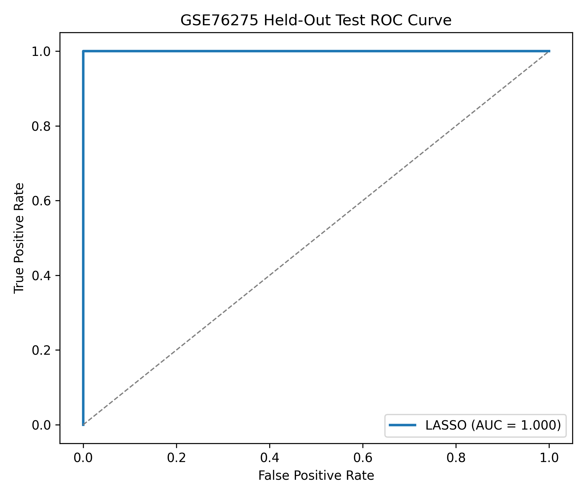

# BioAI-X

## Day 1: Dataset Preparation (`GSE76275`)
- **Dataset:** `GSE76275` (*Homo sapiens* breast cancer microarray data, platform GPL570)
- **Samples:** 265 total (198 TNBC = `1`, 67 non-TNBC = `0`)
- **Notebook:** `day1_tnbc_data.ipynb`

## Day 2: Probe Mapping, DEG Analysis & Visualizations (`GSE76275`)
- **Notebook:** `day2_deg_analysis.ipynb`
- **Probe-to-Gene Mapping:** Mapped GPL570 probe IDs to **21,655** gene symbols across **265** samples (max expression ~15.62, no log2 conversion needed).
- **Differential Expression (DEGs):** Ran Welch's t-test (`TNBC` vs. `non-TNBC`) with Benjamini-Hochberg FDR correction, identifying **13,496** significant genes (`FDR < 0.05`).
- **Outputs:** `top500_DEGs.csv`, `tnbc_top500.csv`, `pca.png`, and `volcano.png`.

Day 2: DEG analysis and plots done.

## Day 3: Leak-Free Machine Learning Classification & LASSO Biomarker Selection (`day3_ml_model.ipynb`)

### Objective
Train and evaluate supervised machine learning classifiers on the `GSE76275` gene expression matrix (`265` samples × `21,655` genes) to distinguish **Triple-Negative Breast Cancer (TNBC, `n = 198`)** from **Non-TNBC (`n = 67`)** without data leakage, and extract a minimal, high-signal biomarker signature.

### Leak-Free Methodology
* **Train/Test Split:** Stratified 70/30 split (`random_state=42`, `stratify=y`) separating `185` training samples (`139` TNBC, `46` Non-TNBC) from `80` held-out test samples (`59` TNBC, `21` Non-TNBC).
* **Pipeline Architecture (Zero Data Leakage):** Rather than pre-filtering features on the full dataset, univariate feature selection (`SelectKBest(f_classif, k=500)`) and feature scaling (`StandardScaler`) were encapsulated strictly inside scikit-learn `Pipeline` objects so transformations are fitted only inside training folds:
  1. **L1-Regularized Logistic Regression (`lasso`):** `StandardScaler` (`sc`) → `SelectKBest(k=500)` (`sel`) → `LogisticRegression(penalty="l1")` (`clf`)
  2. **Random Forest Classifier (`rf`):** `SelectKBest(k=500)` (`sel`) → `RandomForestClassifier` (`clf`)
* **Validation & Evaluation:** Evaluated via 5-fold `StratifiedKFold` cross-validation (`roc_auc`) on `X_train`, followed by final evaluation on the untouched `X_test` set.

### Model Performance
* **LASSO Logistic Regression:** 5-Fold CV ROC-AUC = `[YOUR_LASSO_CV_AUC]` | Held-Out Test ROC-AUC = `[YOUR_LASSO_TEST_AUC]`
* **Random Forest Classifier:** 5-Fold CV ROC-AUC = `[YOUR_RF_CV_AUC]` | Held-Out Test ROC-AUC = `[YOUR_RF_TEST_AUC]`

### Sparse Biomarker Signature (`top20_biomarkers.csv`)
L1 regularization compressed the 500 `SelectKBest` candidate genes down to a **6-gene non-zero predictive signature**:

| Rank | Gene Symbol | LASSO Coefficient | Absolute Weight | Regulation in TNBC |
| :---: | :--- | :---: | :---: | :--- |
| 1 | `COL18A1-AS1` | -1.3859 | 1.3859 | Down-regulated (-) |
| 2 | `AX746627` | -0.7040 | 0.7040 | Down-regulated (-) |
| 3 | `FZD9` | +0.2604 | 0.2604 | Up-regulated (+) |
| 4 | `C5orf49` | -0.1098 | 0.1098 | Down-regulated (-) |
| 5 | `IL5RA` | +0.0889 | 0.0889 | Up-regulated (+) |
| 6 | `RP11-55K13.1` | -0.0494 | 0.0494 | Down-regulated (-) |

### Day 3 Files Added
* `day3_ml_model.ipynb` — End-to-end Colab notebook implementing stratified splitting, leak-free `Pipeline` training, 5-fold CV, test set evaluation, and LASSO coefficient extraction.
* `roc_curve.png` — Held-out test set ROC curve comparing classifier discrimination performance.
* `top20_biomarkers.csv` — Ranked non-zero LASSO biomarker genes with signed coefficients and expression direction.

* ## Day 4: Machine Learning-Based Biomarker Prioritization

### Objective
To identify and prioritize potential biomarker genes associated with Triple-Negative Breast Cancer (TNBC) using machine learning techniques.

### Methods
- Applied LASSO-based Logistic Regression for feature selection.
- Used Random Forest to evaluate feature importance.
- Identified and ranked candidate biomarker genes.
- Generated expression boxplots for selected top candidate genes.
- Evaluated model performance using a held-out test set.
- Compared selected biomarker candidates with published research literature.

### Tools and Libraries
Python, Pandas, NumPy, Scikit-learn, Matplotlib.

### Outputs
- `top20_biomarkers.csv`
- `rf_top20.csv`
- `top5_boxplots.png`

### Validation and Limitations
Biomarker evaluation included held-out test-set assessment and literature-based evidence. Some candidate findings showed conflicting or insufficient published evidence. Independent-cohort validation remains future work.

---

## Day 5: Pathway Enrichment and Protein–Protein Interaction Analysis

### Objective
To explore the biological pathways associated with selected candidate genes and investigate their protein–protein interaction relationships.

### Part 1: Pathway Enrichment Analysis
- Selected the top 500 ranked genes from differential expression analysis.
- Performed enrichment analysis using GSEApy.
- Investigated GO Biological Process 2023 and KEGG 2021 Human gene sets.
- Generated a pathway enrichment results table.
- Created a bar plot to visualize the top enrichment results.

**Observation:** The displayed top pathway results did not show statistically significant enrichment at an adjusted p-value threshold of 0.05.

### Part 2: Protein–Protein Interaction Analysis
- Selected 15 candidate proteins for network analysis.
- Used the STRING database with Homo sapiens as the organism.
- Generated a protein interaction network.
- Exported interaction details and node-degree information.

**Key Findings:**
- Proteins analysed: 15
- Unique interaction pairs: 1
- Identified interaction: CCDC170–CCDC96
- Combined interaction score: 0.403
- Proteins with zero connections: 13

The network was sparse, indicating limited database-supported interactions among the selected proteins at the chosen settings. STRING associations do not necessarily represent experimentally confirmed physical interactions.

### Tools and Libraries
Python, Pandas, NumPy, GSEApy, Matplotlib, STRING database.

### Outputs
- `pathways.csv`
- `pathways.png`
- `ppi_summary.csv`
- `string_interactions_15_nodes (1).tsv`
- `string_node_degrees_15_nodes (1).tsv`
- `string_evidence_network_hires_15_nodes (1).png`

### Limitations
- Pathway enrichment depends on gene selection and database annotation coverage.
- The STRING network contained only one unique interaction pair.
- Further validation using independent datasets and experimental evidence is required.

- ## Day 6: Drug-Gene Interaction Analysis Using DGIdb

### Objective
To investigate reported drug-gene interactions for the 15 prioritized candidate genes using the Drug-Gene Interaction Database (DGIdb).

### Methodology
- Queried 15 candidate genes using DGIdb.
- Retrieved 47 drug-gene interaction records.
- Examined associated drugs, regulatory approval status, indications, and interaction scores.
- Summarized interaction counts for each candidate gene.
- Generated a bar chart to visualize the interaction counts.

### Key Findings

Six genes had reported DGIdb interactions:

| Gene | Interaction Count |
|---|---:|
| KCNQ4 | 21 |
| FFAR4 | 11 |
| GRIK3 | 9 |
| IL5RA | 3 |
| TNNI2 | 2 |
| ELK1 | 1 |

- Four matched genes had zero returned interactions: FZD9, DLX5, EMID1, and ORC1.
- Five genes were listed as unmatched terms: SKA1, CCDC170, CCDC96, DEFB132, and TDRD10.
- A total of 47 interaction records were retrieved.

### Outputs
- `dgidb_gene_interaction_summary.csv`
- `dgidb_all_interactions.csv`
- `dgidb_gene_interaction_counts.png`
- `day6_dgidb_analysis.ipynb`

### Limitations
- DGIdb records do not establish that a drug is effective against TNBC.
- Unmatched genes should not be interpreted as biologically inactive.
- Regulatory approval status does not establish approval for TNBC treatment.
- Further experimental and independent validation is required.
